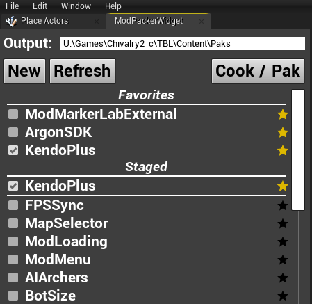
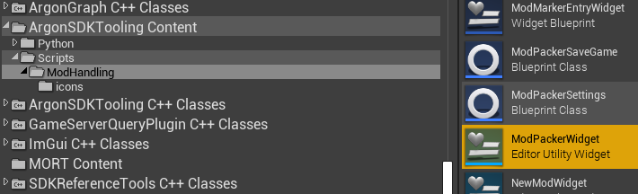
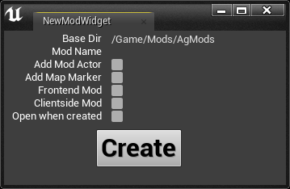
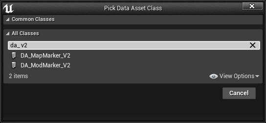
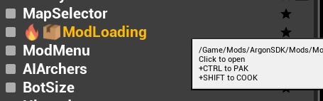
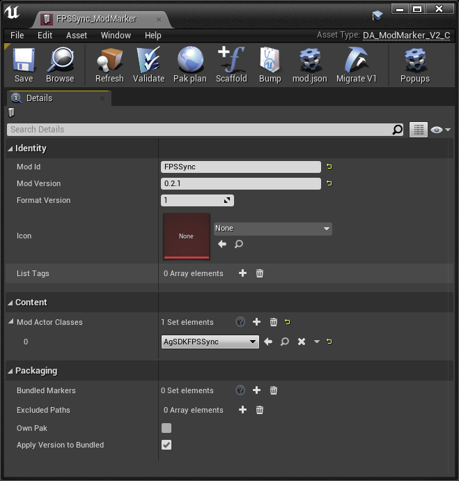
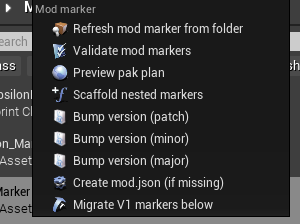
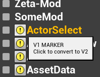
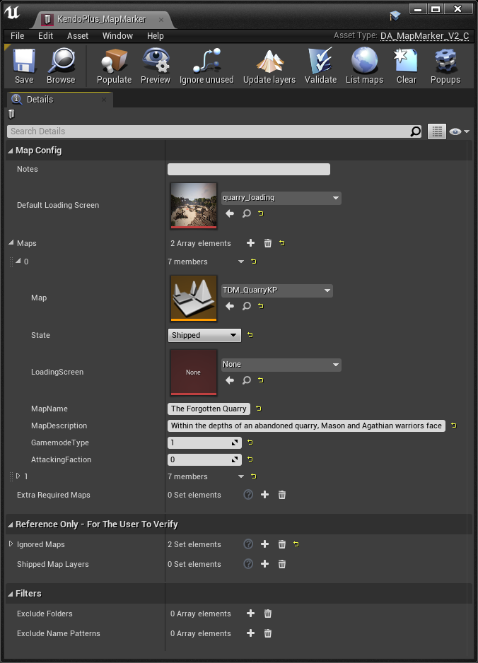

# Packaging Mods with the Mod Packer Widget

The **Mod Packer** is an in-editor widget shipped with ArgonSDK. It is the one place to
turn a mod folder into a shippable Chivalry 2 Unchained `.pak`: it creates mods and their
markers, cooks, and packages them, one at a time or in batches, **without touching Python
or hardcoding any engine/SDK paths**.

What you get:

- **Create** a new mod folder, its mod marker, and (optionally) a map marker and mod actor in one click.
- **Cook** and **package** a single mod or a selection of mods, with simple mouse-modifier shortcuts.
- **Markers** that let the Unchained loader discover your mod (and its maps and loading
  screens) quickly in-game.

> [!NOTE]
> This guide covers the **widget workflow**. For the packaging commands, the CLI, and project
> setup, see the tooling [`README.md`](./README.md). For what the markers and the Mod Asset
> Registry actually are (field-by-field reference), see
> [Mod Markers, Map Markers & the Mod Asset Registry](https://github.com/Chiv2-Community/ArgonSDK/blob/main/docs/mod-markers-and-asset-registry.md).

## Opening the widget

- ArgonSDK is set up so the widget is **docked and visible** on startup.
- The latest SDK supplies the ArgonSDKTooling plugin, the Unchained-Mods submodule, and the
  required `.ini` tweaks. It ships with several community mods embedded as submodules. If the
  list is empty, click **`Refresh`**.
- Set the **output** field to the game's `Paks` directory, or keep the default.

<b>Widget not visible? Launch it manually</b>

In the Content Browser, go to the **ArgonSDKTooling** plugin's `Content → Scripts → ModHandling`,
right-click **`ModPackerWidget`**, and choose **Run Editor Utility Widget**.

If the plugin's Content folder isn't visible, click **View Options** (bottom-right of the Content
Browser) and tick **Show Plugin Content**.

<b>Can't update your SDK from git? Manual setup</b>

Enabling the plugin alone is not enough: the marker menus and the cook behaviour need a couple
of project config entries. The full, authoritative steps (which `.ini` files, which lines) are in
the tooling README's [Project setup](./README.md#project-setup-ini-config-one-time-per-sdk) section.

> [!WARNING]
> `Config/DefaultEngine.ini` is **UTF-16 (with a BOM)**. Edit it as UTF-16, or Unreal silently
> ignores your changes. Restart the editor after editing it.

## Creating a new mod

It's recommended to create new mods with the widget's **`New`** button rather than by hand.

1. Click **`New`** and enter a name in the **`Mod Name`** field.
2. (Optional) tick the checkboxes below for a map marker and/or a mod actor.
3. Click **`Create`**.

| Option | What it does |
|---|---|
| **`Mod Name`** | Name of the new mod; becomes its subfolder and its `ModId`. |
| **`Add Map Marker`** | Also creates a map marker; tick this if the mod will ship maps. |
| **`Add Mod Actor`** | Creates an `ArgonSDKModBase` asset and registers it in the mod marker (as a `ModActorClasses` entry). |
| **`Create`** | Creates the subdirectory and a mod marker (`DA_ModMarker_V2`). |

<b>Creating a marker by hand</b>

If you ever need to create a marker manually (mod or map):

Right-click in the Content Browser → **Miscellaneous → Data Asset**, then pick the marker class
in the class picker.

## Cooking & packaging a single mod

The widget cooks and packages individual mods, so you don't need the editor's **Cook for Windows**.
Use your mouse with modifier keys on a mod entry:

| Input | Action |
|---|---|
| **Click** | Open the mod's folder in the Content Browser |
| **Shift + Click** | **Cook** the mod |
| **Ctrl + Click** | **Package** (pak) the mod |
| **Ctrl + Shift + Click** | **Cook, then package** the mod |

> [!NOTE]
> The editor's **Cook for Windows** processes the **entire** Content directory. The Mod Packer
> cooks only the mod (or mods) you pick.

- Cooking creates a subdirectory per mod under `<SDK>\Saved\CookedMod\`.
- Cooking is **iterative** by default, so unchanged content isn't re-cooked.
- The finished `.pak` is written to the **output** folder set at the top of the widget.

> [!IMPORTANT]
> Paks are split at **500 MB** by default, so each part stays within GitHub release file limits.
> When a mod's packaged content is larger, the widget writes several paks named
> `<ModId>_part1.pak`, `<ModId>_part2.pak`, …. The mod registry treats **one pak per release**,
> so the parts of a multi-part mod are published separately.

## Cooking & packaging multiple mods

- The **checkbox** to the left of a mod marks it for staging.
- The **`Cook/Pak`** button processes all staged mods at once.
- The same modifier-key logic from the single-mod table applies to this button
  (Shift = cook, Ctrl = pak, Ctrl + Shift = cook then pak).

## Markers

Markers are small data assets that tell the tooling what to cook and pack, and tell the
in-game Unchained loader how to discover your mod and its maps. There are two kinds, **mod
markers** and **map markers**, and both offer **tool-menu buttons** (in the asset editor) and
**right-click context-menu** actions in the Content Browser.

> [!NOTE]
> This section is a practical overview. For the full, field-by-field schema of each marker, see
> [Mod Markers, Map Markers & the Mod Asset Registry](https://github.com/Chiv2-Community/ArgonSDK/blob/main/docs/mod-markers-and-asset-registry.md).

### Mod Marker

Mod markers (`DA_ModMarker_V2`) are used for mod detection/discovery inside the UE Editor and by
the in-game mod loader.

**New in V2:**

| Feature | What it gives you |
|---|---|
| **Bundled mods** | Adding a marker to **`Bundled Markers`** produces a single pak containing multiple mods. A checkbox lets you instead produce a separate pak for each bundled mod (off by default). |
| **Mod versioning** | The version is read from **`mod.json`** and propagated to referenced markers (**`Refresh`** syncs the `mod.json` and marker version fields). You can generate a `mod.json` from the editor and bump the **Major / Minor / Patch** version (the tool menu bumps patch; the context menu offers all three). Before cooking, the `mod.json` version is propagated to the marker and its listed `Mod Actor Classes`, and for bundled markers to the nested markers and actors too. |
| **Excluded paths** | Use the **`Excluded Paths`** array to keep directories and assets out of the cook and pak (supports wildcards). |

> [!NOTE]
> **`Icon`** and **`List Tags`** already exist on the marker, so set them now. The in-game mod
> loader does not yet **display** the icon or **filter** by tags; that UI is still to come. The
> values ship and are read by the loader in the meantime.

Right-clicking a mod marker offers the same actions as the tool menu:

#### Converting V1 mod markers to V2

Old V1 markers can be converted to V2 from the **ModPackerWidget** button or the marker's
right-click context menu.

### Map Marker

The map marker (`DA_MapMarker_V2`) specifies which maps get cooked and packaged within a mod.

| Feature | What it does |
|---|---|
| **Custom loading screens** | **`DefaultLoadingScreen`** sets the texture for every referenced map; it can be overridden per map. (Works with the newest UnchainedPlugin.) |
| **Automatic sublevel pickup** | Add only the base level (e.g. `TDM_QuarryKP`) to **`Maps`**; the cook script picks up the sublevels it loads. Click **`Update layers`** to populate a reference array you can inspect; that array is for your eyes only and is not used during cooking. |
| **Map state (`Shipped` / `Held`)** | Withhold maps from the cook/pak, e.g. unfinished variants or test maps. |
| **Exclusions** | Skip folders or filename patterns from consideration. |

**Example workflows**

A single map (with or without sublevels):

1. Click **`Populate`** to fill the `Maps` array.
2. (Optional) set **`DefaultLoadingScreen`**.

A mod with multiple maps:

1. Add entries to the **`Maps`** array: drag-and-drop a map onto the field, or use the asset picker.
2. Click **`Refresh`** to populate each map's **`MapName`**, **`MapDescription`** and faction fields.
3. (Optional) click **`ignore unused`** and check whether you missed any maps.
4. (Optional) click **`Update layers`** and check they're all present. If a sublevel loads only on
   demand, add it to **`Extra Required Maps`**.

> [!TIP]
> **`Populate`** only adds maps that are **not** in the **`Ignored Maps`** array. This enables an
> alternative workflow: populate the ignored maps first, remove the ones you want to keep, then
> click **`Populate`**.
